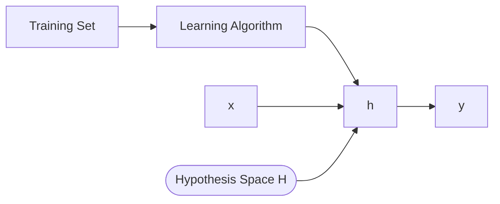
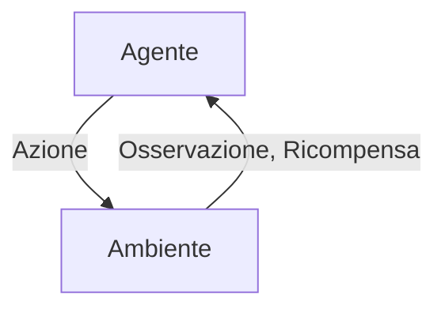

# Tipi di Apprendimento
## Apprendimento Supervisionato
>[!note] Obiettivo
> Dare la risposta esatta per ogni esempio nei dati

Dati gli esempi $\{(x^{(i)}, y^{(i)})\}$ impara una funzione (descrizione) che cattura le informazioni contenute negli esempi.
Praticamente cerchiamo una funzione $h(\cdot)$ che è in grado di mappare in maniera predicibile le $x$ con le $y$, ovvero $h: X \to Y$.
Un esperto provvede la supervisione, ovvero i valori $h(\cdot)$ corrispondenti alle istanze $x^{(i)}$
**Output**: Classificazione (valore discreto) vs Regressione (valore reale)

>[!important] Importante
>$h$ approssima la funzione obiettivo (sconosciuta):
>$$
>h \approx f: X \to Y
>$$

## Apprendimento non supervisionato

> [!note] Obiettivo
> Trovare pattern regolari nei dati

Dati esempi $\{ x^{(i)} \}$ scopre regolarità in tutto il dominio di input, non c'è un esperto (ovvero nessuna supervisione) 
![[Pasted image 20260210103202.png|center]]

## Apprendimento rinforzato
Qui c'è un agente che:
- È in uno stato $s$
- Esegue azione $a$ (tra le possibili nello stato $s$)

Opera in un ambiente $e$, che risponde all'azione $a$ dello stato $s$ ritorna:
- Il prossimo stato
- Una ricompensa (che può essere positiva, negativa, neutrale)

Obiettivo dell'agente è quello di massimizzare la funzione delle ricompense

