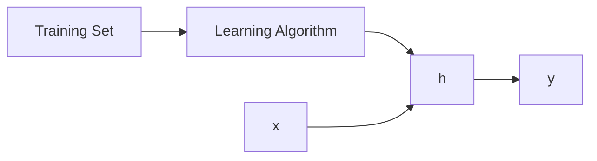

## Ingredienti Fondamentali
- Dati per il training $D$ (presi dall'istanza di spazio $X$)
- Ipotesi di spazio $H$:
  - Ovvero l'insieme di funzioni che possono essere implementate dal sistema dalla ML
  - Assumiamo che la funzione che deve essere imparata $f$ possa essere rappresentata/approssimata dall'ipotesi $h \in H$.
- Algoritmo di apprendimento: Si può vedere come un algoritmo di ricerca in $H$

>[!warning] Bias Induttivo (di apprendimento)
>Che può essere nella rappresentazione di $H$ e/o nella ricerca (algoritmo di ricerca)

>[!def] Bias Induttivo
> Insieme di **assunzioni** sulla *natura* della funzione obiettivo e sul **criterio di selezione** dell’ipotesi.
> 
> Guida l’apprendimento quando i dati non sono sufficienti a determinare un’unica soluzione.
> 
> **Tipi di bias**
> - **Restrittivo**: limita lo **spazio delle ipotesi**  $\to$ alcune soluzioni sono escluse *a priori*
> - **Di preferenza**: impone un **ordinamento** nello spazio delle ipotesi  $\to$ tutte le ipotesi sono ammesse, ma alcune sono preferite
>   
>  
>>[!note]
>>Senza bias induttivo l'apprendimento è impossibile

### Esempi di Bias Induttivo

> [!def] Regressione lineare — bias induttivo
> Bias **restrittivo**: si assume che la funzione obiettivo sia **lineare**, escludendo tutte le funzioni non lineari.

> [!def] k-Nearest Neighbors — bias induttivo
> Bias **di preferenza**: tra le ipotesi compatibili con i dati, privilegia quelle **localmente continue**.

> [!important]
> Algoritmi diversi ≠ dati diversi  $\to$ **bias diversi producono ipotesi diverse sugli stessi dati**

### Bias-Varianza Tradeoff
>[!def] Bias (underfitting)
>L'errore di **bias** è prodotto facendo assunzioni **troppo forti/restrittive** nell'algoritmo di apprendimento. 
>Un bias alto può causare la perdita di rilevanza di alcuni dati da parte dell'algoritmo. (**underfitting**)

>[!def] Varianza (overfitting)
>L'errore di **varianza** è prodotto dalla troppa sensitività a fluttuazioni minime (rumore) nei dati di allenamento. 
>Una varianza alta può portare a modellare rumore random presente nei dati di allenamento, piuttosto che gli output attesi (**overfitting**)

> [!note]
> Il bias induttivo controlla il compromesso bias–varianza:  
> bias troppo restrittivo $\to$ underfitting,  
> bias troppo flessibile $\to$ overfitting.

![[Pasted image 20260210111406.png]]

## Regressione Lineare
Esempio: Prezzi delle case di Portland
Notazione:
- $m$: Numero di esempi di allenamento
- $x$: variabile di input
- $y$: variabile di output

Dove $h$ mappa le $x$ alle $y$.
>[!question] Come rappresentiamo $h$?
>La rappresentiamo con il **modello di regressione lineare univariato** (ovvero con 1 variabile)
>$$
>h_{\theta}(x) = \theta_{0} + \theta_{1}x
>$$

Dunque abbiamo:
- Training set
- Ipotesi: $h_{\theta}(x) = \theta_{0} + \theta_{1}x$ dove $\theta_{i}$ sono **parametri**

---

>[!question] Come scegliamo i parametri?

Iniziamo con un esempio semplice:

|  x  |  y  |
| :-: | :-: |
|  1  |  6  |
|  2  |  5  |
|  3  |  7  |
|  4  | 10  |
Con ipotesi $h_{\theta}(x) = \theta_{0} + \theta_{1}x$.

**Idea**: scegliere $\theta_{0}, \theta_{1}$ cosicchè $h_{\theta}(x)$ è vicino a $y$ per i nostri esempi di allenamento $\{ (x_{i}, y_{i}) \}$ $\to$ somma delle distanze (al quadrato) (residui) (somma scarti quadratici)

![[Pasted image 20260210115740.png|center]]

- Residui: $\{ h_{\theta}(x_{i}) - y_{i} \}$
- Funzione di Costo: $J(\theta_{0}, \theta_{1}) = \frac{1}{2m} \sum_{i = 1}^m (h_{\theta}(x_{i})-y_{i})^2$
- Obiettivo: $\text{min}_{\theta_{0}, \theta_{1}} J(\theta_{0}, \theta_{1})$ (Ricerca Operativa <3, dove la funzione di costo è la funzione obiettivo)

>[!question] Ora come scegliamo $\theta_{i}$?
>Vediamo degli esempi:
>![[Pasted image 20260210120325.png]]

se ho $h_{\theta}(x) = \theta_{1}x$
![[Pasted image 20260302145248.png]]
$$
J(\theta_{1}) = \frac{1}{2m}\sum_{i = 1}^m(h_{\theta}(x^i - y^i)^2 = \frac{1}{2m}\sum_{i = 1}^m(\theta_{1}x^i - y^i)^2 = \frac{1}{2m}(0+0+0)^2 = 0
$$
![[Pasted image 20260302145544.png]]
$$
J(0.5) = \frac{1}{2m}[(0.5-1)^2 + (1 - 2)^2 + (1.5 - 3)^3] = \frac{1}{6}[0.25 + 1 + 2.25] \approx 0.67
$$
![[Pasted image 20260302145846.png]]
$$
J(0) = \frac{1}{2m}[(0-1)^2 + (0-2)^2 + (0-3)^2] = \frac{1}{6}[1+4+9]\approx 2.33
$$
==Quindi per differenti valori di $J(\theta_{1})$== abbiamo:
![[Pasted image 20260302150057.png]]
Ora con 2 parametri abbiamo:
![[Pasted image 20260302150207.png]]
Per trovarne il minimo usiamo la tecnica del **Gradient Descent**.

### Gradient Descent
Con questa tecnica iniziamo con una configurazione dei parametri $\theta_{i}$ e continuiamo a cambiare i parametri $\theta_{i}$ per ridurre la funzione di costo $J$ finché sperabilmente arriviamo ad un minimo.
Idealmente dovrebbe succedere questo:
![[Pasted image 20260302150525.png]]
![[Pasted image 20260302150729.png]]

La formula del gradient descent:
$$
\theta_{k+1} = \theta_{k} - \eta \nabla J(\theta_{k}) 
$$
dove:
- $\eta > 0$ è il "learning rate"
- $\nabla$ è il gradiente: un vettore che contiene le derivate parziali della funzione, ovvero dice come cambia il costo $J$ se sposto di poco ogni singolo $\theta$
- Dopo ogni aggiornamento, il gradiente viene ri-calcolato per il nuovo vettore $\theta_{k+1}$, il processo si ripete

>[!important]
>Lo scopo non è far diventare $\theta$ uguale a zero, ma far sì che il **gradiente** $\nabla J(\theta)$ diventi (o si avvicini il più possibile a) **zero**.
>Questo perché significa che o sei sul minimo globale oppure locale.

>[!note] Nota
> La funzione di costo viene calcolata nell'intero "training set", così da calcolare $\nabla J$ (batch method)
